<div align="center">

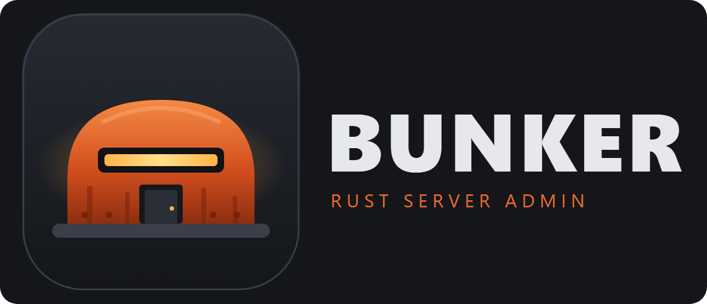

### 🛡️ The desktop admin console for your **Rust** server
Watch the console, see who's online and run your server, without ever launching the game.

<br>

[](https://github.com/Russ773/Bunker/releases/latest)
[](https://github.com/Russ773/Bunker/releases)
[](https://github.com/Russ773/Bunker/actions)
[](#-download)
[](https://dotnet.microsoft.com/)

[](#-getting-started)
[](#-getting-started)
[](docs/WIDGETS.md)
[](#-screenshots)
[](#-safety--privacy)


<br>

**[⬇️ Download](#-download)** &nbsp;·&nbsp; **[✨ Features](#-features)** &nbsp;·&nbsp; **[🖼️ Screenshots](#-screenshots)** &nbsp;·&nbsp; **[🚀 Getting started](#-getting-started)** &nbsp;·&nbsp; **[🧩 Widgets](#-community-widgets)** &nbsp;·&nbsp; **[🛠️ Build](#-build-from-source)** &nbsp;·&nbsp; **[🗺️ Roadmap](#-roadmap)**

</div>

<br>

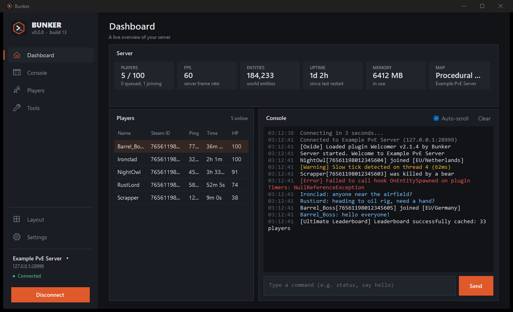

---

## ⬇️ Download

<div align="center">

[](https://github.com/Russ773/Bunker/releases/latest)

</div>

1. Grab **`Bunker-Setup-x.y.z.exe`** from the [latest release](https://github.com/Russ773/Bunker/releases/latest).
2. Run it. It installs just for you, with no admin prompt.
3. Start **Bunker** and enter your server's RCON details. That's it.

> 💡 Windows SmartScreen may say the publisher is unknown, because the installer isn't code-signed yet
> (see [Code signing policy](#-code-signing-policy)). Choose **More info → Run anyway**.
> If Windows 11's Smart App Control blocks it outright, right-click the downloaded file, open
> **Properties** and tick **Unblock** before running it.

---

## ✨ Features

| | |
| --- | --- |
| 📊 **Dashboard** | Live players, FPS, entities, uptime, memory and map, with the player list and console in one glance. |
| 🖥️ **Console** | Colour-coded output, command history with ↑/↓, **search and filters** (hide chat, warnings, errors), auto-scroll, and your choice of **font and size** with a live preview. |
| 👥 **Players** | Who's online with ping, time played and health. Right-click to copy a Steam ID, kick or ban. |
| 📈 **Server health** | Live charts of FPS, players, entities and memory over 5 minutes to 2 hours. Hover for exact values, and spot lag spikes and restarts at a glance. |
| ⏰ **Scheduler** | Automation: recurring announcements, a daily world save, restart warning sequences with `wait` steps. Shows each schedule's next run. |
| 🗂️ **Player database** | Everyone who has joined: first and last seen, time played, visits, and **your own notes**. Plus a live **join and leave feed**. |
| 💬 **Chat monitor** | Watch-words that highlight messages and flash the taskbar, with mute, kick and ban right from a message. |
| 🧰 **Admin tools** | **Announce**, **Quick actions**, **Moderation**, **Teleport**, **Shortcuts** and **Give items**, each with the live console beside it so you see the server's reply. |
| 🧩 **Community widgets** | Install widgets other people have made. They can show live stats, command replies and run timed sequences, and are reviewed command by command first. [Write your own →](docs/WIDGETS.md) |
| 🪟 **Your own layout** | Pick 1, 2 or 4 sections and choose what goes in each. Go **fullscreen** for a wall-display control room. |
| 🌐 **Multiple servers** | Save as many servers as you like and switch from the sidebar. Passwords are encrypted for your Windows account. |
| 🎨 **Dark & light themes** | Easy on the eyes at 3 a.m., readable in daylight. |
| 🔄 **Updates that ask first** | Bunker checks for new versions and *asks* before installing anything. |
| 🔌 **Reconnects gracefully** | Waits a moment after launch, then retries if the server isn't ready. |

---

## 🖼️ Screenshots

<table>
  <tr>
    <td width="50%">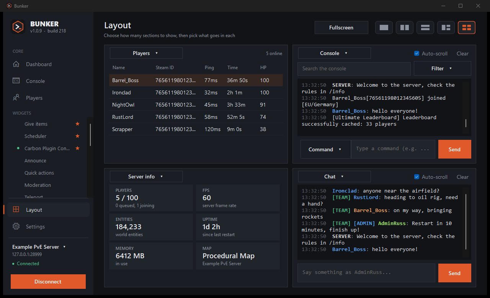<br><sub><b>🪟 Build your own layout</b>: players, console, server info and chat</sub></td>
    <td width="50%">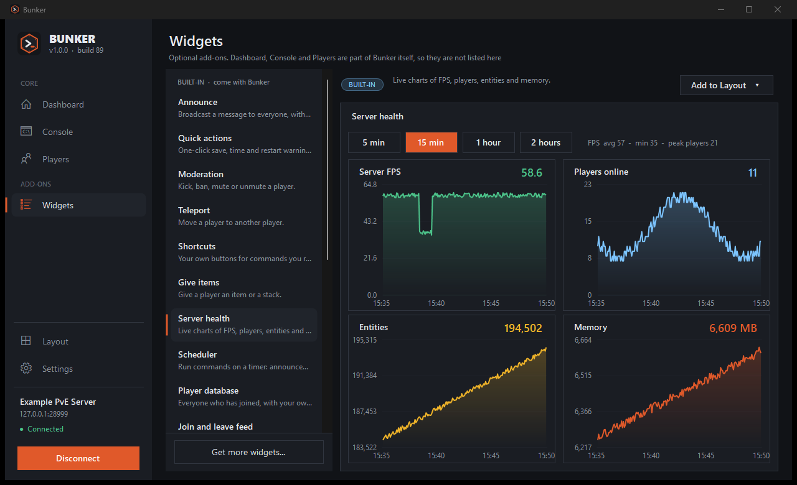<br><sub><b>📈 Server health</b>: live charts with a time window</sub></td>
  </tr>
  <tr>
    <td width="50%">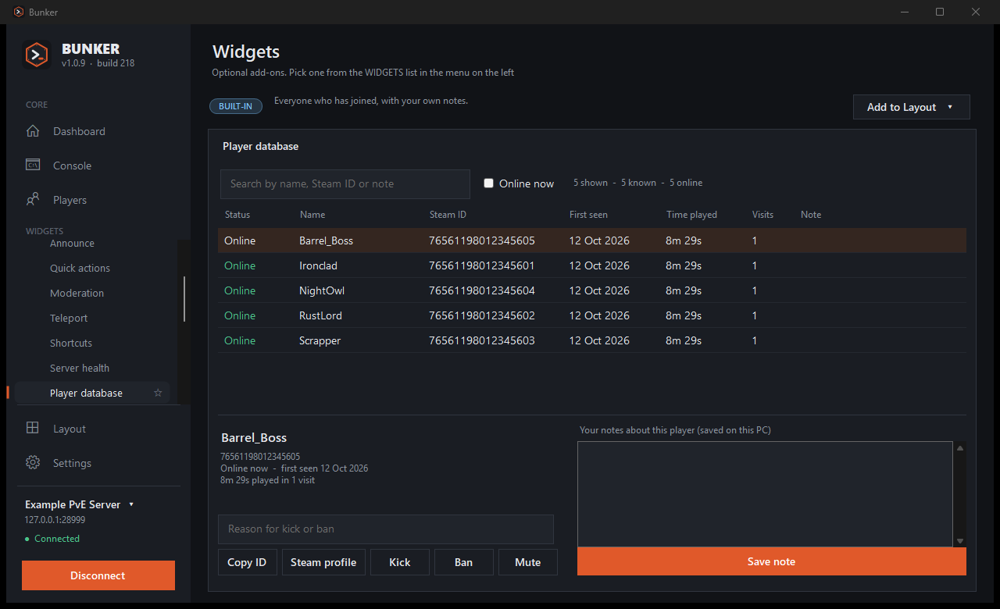<br><sub><b>🗂️ Player database</b>: history and your own notes</sub></td>
    <td width="50%">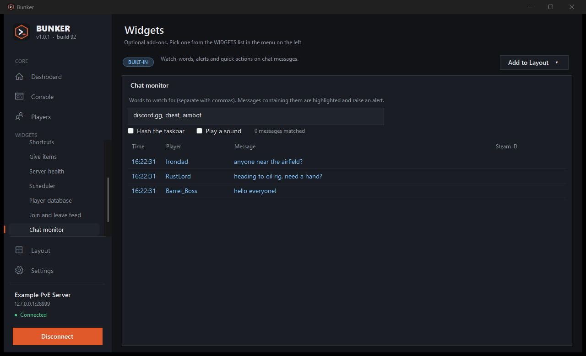<br><sub><b>💬 Chat monitor</b>: watch-words and one-click actions</sub></td>
  </tr>
  <tr>
    <td width="50%">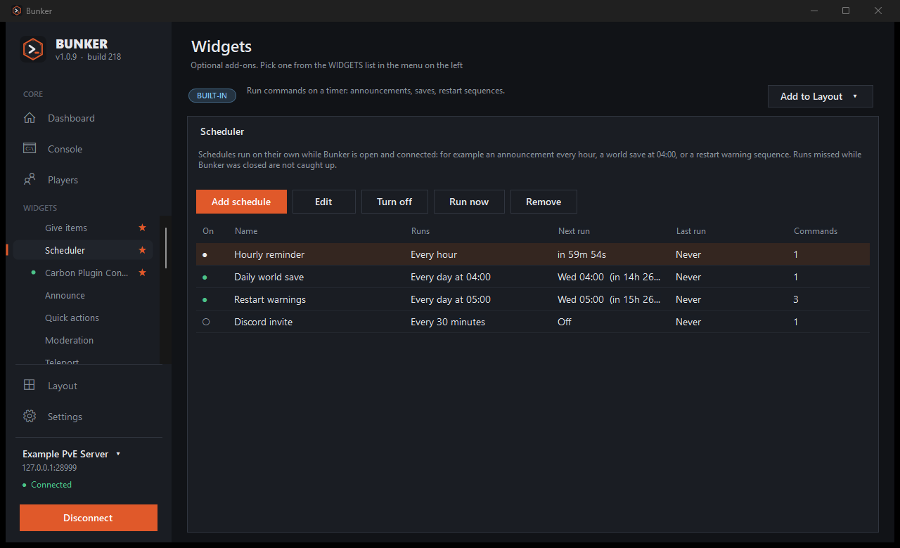<br><sub><b>⏰ Scheduler</b>: announcements, saves and countdowns on a timer</sub></td>
    <td width="50%">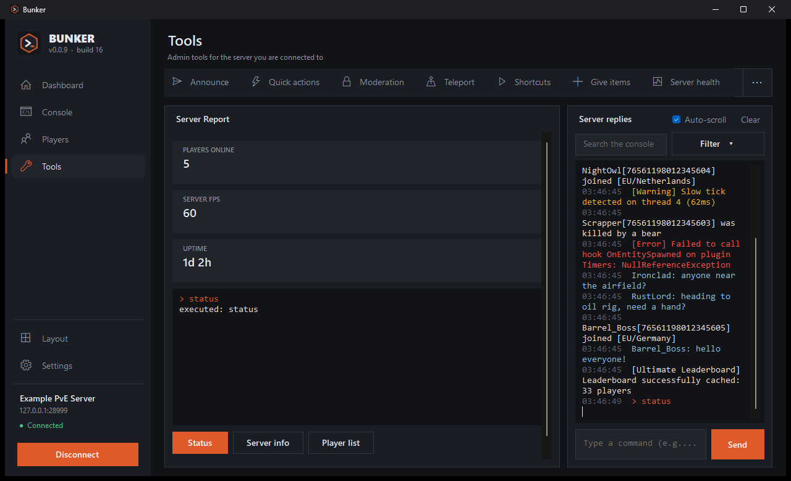<br><sub><b>🧩 Community widgets</b>: live stats and replies, here the Server Report</sub></td>
  </tr>
  <tr>
    <td width="50%">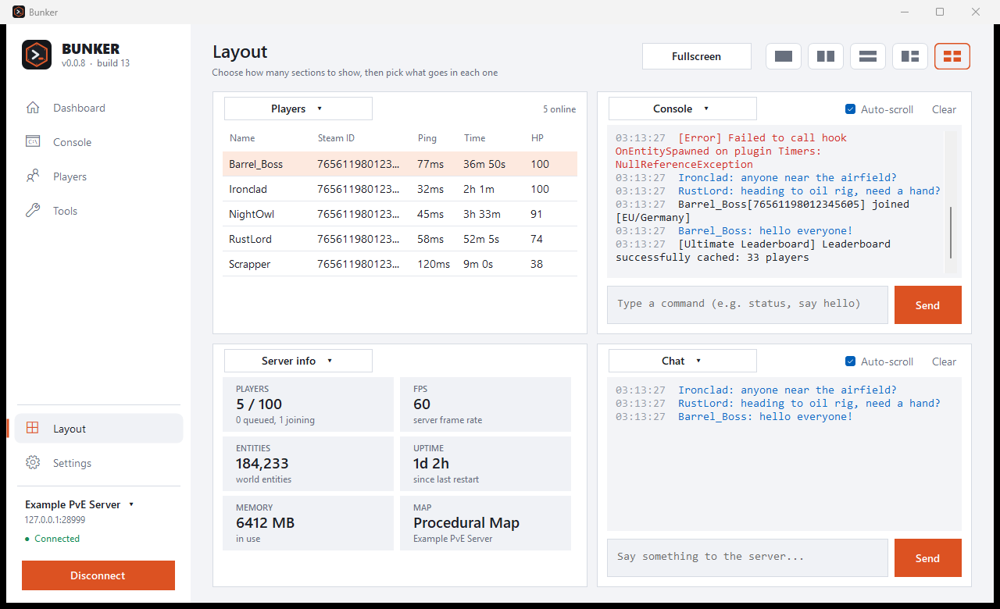<br><sub><b>☀️ Light theme</b>: one switch in Settings</sub></td>
    <td width="50%">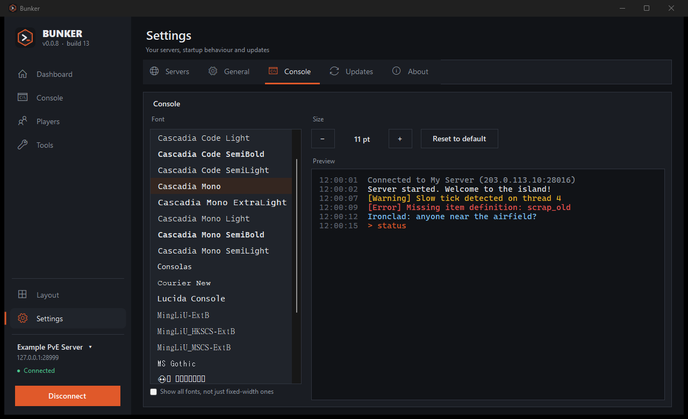<br><sub><b>🔤 Console font &amp; size</b>, with a live preview</sub></td>
  </tr>
</table>

---

## 🚀 Getting started

### 1. Turn on WebRCON on your Rust server

Add these to your server's startup parameters, then restart it:

```text
+rcon.web 1 +rcon.port 28016 +rcon.password "choose-a-strong-password"
```

Make sure the RCON port (`28016` here) is reachable from your PC. On a hosted server that usually means opening it in the firewall.

### 2. Connect

Start Bunker. The welcome screen asks for:

| Field | Example |
| --- | --- |
| Server name | `My Rust Server` (optional) |
| Server address | `123.45.67.89` or `play.example.com` |
| RCON port | `28016` |
| RCON password | the one you set above |

Press **Test & connect**. Bunker checks the connection before saving anything. Offline right now? Choose **Save without testing**.

### 3. Explore

* **Dashboard** is your overview. **Console** is the full live console.
* **Tools** has the admin helpers. **Layout** lets you build your own screen.
* Click the server name in the sidebar to switch servers. **Settings** has themes, fonts, startup options and updates.

> ⌨️ **Tips:** `↑`/`↓` recall previous commands · `Esc` or `F11` leaves fullscreen · right-click a player for quick actions · hover long names for a tooltip.

---

## 🧩 Community widgets

A **widget** is a small `.json` file, **never a program**. It describes some fields and buttons, and lists every console command each button can send:

```json
{
  "id": "resource-drop",
  "name": "Resource Drop",
  "description": "Reward everyone online with a resource.",
  "controls": [
    { "type": "choice", "id": "item", "label": "Resource", "options": ["wood", "stones", "scrap"] },
    { "type": "number", "id": "amount", "label": "Amount each", "default": 500, "min": 1, "max": 5000 },
    {
      "type": "button",
      "text": "Give to everyone",
      "confirm": "Give {amount} x {item} to EVERY player?",
      "commands": [ "inventory.giveall {item} {amount}", "say \"Everyone just received {amount} {item}!\"" ]
    }
  ]
}
```

* 🔍 **Reviewed before install.** Bunker lists *every* command a widget can send, and marks risky ones (kick, ban, restart, give-to-everyone…) with `!`.
* 🚫 **Hard limits.** Widgets can't touch RCON settings or admin rights, can't run scripts and can't reach the network.
* 🧼 **Cleaned inputs.** Text typed into a widget has quotes, semicolons and control characters removed before it's used.
* ⚡ **More than buttons.** Widgets can show **live server stats**, display the server's **replies** in a panel, and run **timed sequences** with a Stop button, such as countdowns.
* 📚 **Try the starters** in [`widgets/`](widgets): *Welcome Packs*, *Broadcast Presets*, *Resource Drop*, *Event Countdown*, *Server Report*, *Ban Manager* and *Oxide Plugin Control*. Install them from **Tools → Widgets → Browse library**.

Want to make one? Read the **[widget guide](docs/WIDGETS.md)** and open a pull request. 💜

---

## 🔒 Safety & privacy

* 🔐 **RCON passwords are encrypted** with Windows DPAPI, so only your Windows account can read them.
* 📡 Bunker talks to **your server** and to **GitHub** (to check for updates and, if you open it, the widget library). Nothing else, and no analytics.
* 🙋 **Updates always ask first.** Nothing installs without your OK.
* 🧪 The widget safety rules have **automated tests** that run on every release.

---

## ✍️ Code signing policy

Bunker is open source (MIT) and is applying for free code signing from [SignPath Foundation](https://signpath.org).
**Until that is approved, releases are not signed**, which is why Windows shows an unknown publisher.
Once approved, this section will read: *Free code signing provided by [SignPath.io](https://signpath.io), certificate by [SignPath Foundation](https://signpath.org).*

How signing will work:

* Only builds made by this repository's [release workflow](.github/workflows/release.yml) on GitHub Actions are signed, from the tagged source code. Nothing is signed from a developer's own machine.
* `Bunker.exe` and the installer are signed. Both are built from the source in this repository.
* Every release needs manual approval before it is signed.
* **Authors, reviewers and approvers:** [Russ773](https://github.com/Russ773). Two-factor authentication is required for the repository and the signing service.
* **Privacy:** Bunker doesn't send data anywhere except to your own server and to GitHub (see [Safety & privacy](#-safety--privacy)).

---

## 📟 Rust commands Bunker uses

| Feature | Commands |
| --- | --- |
| Live data | `serverinfo`, `playerlist` |
| Chat & announcements | `say` |
| Quick actions | `server.save`, `env.time`, `restart` |
| Moderation | `kick`, `banid`, `unban`, `mute`, `unmute`, `server.writecfg` |
| Teleport | `teleport` |
| Give items | `inventory.giveto`, `inventory.giveall` |

> ℹ️ Command syntax follows public Rust admin references and can differ between server versions or plugins. The server's reply always appears in the console, so you can see exactly what happened.

---

## 🛠️ Build from source

You need Windows and the [.NET 10 SDK](https://dotnet.microsoft.com/download).

```bash
git clone https://github.com/Russ773/Bunker.git
cd Bunker

dotnet run --project src          # run it
dotnet test tests/Bunker.Tests    # run the tests
```

<details>
<summary><b>📁 Project layout</b></summary>

```text
Bunker/
├── src/                  The WinForms app (C#, .NET 10)
│   ├── Core.cs             connection, console log, server monitor
│   ├── RconClient.cs       WebRCON client
│   ├── *Page.cs            Dashboard, Console, Players, Tools, Layout, Settings
│   ├── *View.cs            widgets: console, players, charts, scheduler, player database, chat monitor, admin tools
│   └── CommunityWidgets.cs the safe widget format, rules and store
├── tests/Bunker.Tests/   xUnit tests (widget rules and bundled widgets)
├── widgets/              starter community widgets
├── docs/                 widget guide and screenshots
├── installer/            Inno Setup script and wizard artwork
├── assets/               logo and icon sources
└── .github/workflows/    CI, release and upload pipelines
```

</details>

<details>
<summary><b>🚢 How a release works</b></summary>

Pushing a tag such as `v0.0.9` runs the pipeline:

1. 🧪 run the tests
2. 🏗️ publish a self-contained Windows build
3. 📦 build the Inno Setup installer
4. 🚀 publish a GitHub Release

</details>

---

## 🗺️ Roadmap

- [x] Live dashboard, console and player list
- [x] Admin tools: announce, quick actions, moderation, teleport, give items, shortcuts
- [x] Custom layouts and fullscreen mode
- [x] Multiple saved servers
- [x] Dark and light themes, console font and size
- [x] Community widgets with safe, reviewable commands, live stats, replies and timed steps
- [x] Server health charts, scheduler, player database and chat monitor
- [x] Console search and filters
- [ ] Auto-reconnect when the connection drops mid-session
- [ ] Ban list and plugin list as proper tables (once the servers' reply formats are confirmed)
- [ ] Widget library submissions through the app
- [ ] Code-signed installer

Have an idea? [Open an issue](https://github.com/Russ773/Bunker/issues) or build a [widget](docs/WIDGETS.md).

---

## 🤝 Contributing

Pull requests are welcome (under the [MIT License](LICENSE)), especially **widgets** (add a `.json` file to [`widgets/`](widgets) and list it in `widgets/index.json`) and bug reports with the steps to reproduce them. Please run `dotnet test tests/Bunker.Tests` before you open a PR.

---

<div align="center">

<sub>Released under the [MIT License](LICENSE).</sub>

<sub>Bunker is an independent community tool. **Rust** is a trademark of Facepunch Studios; Bunker is not affiliated with or endorsed by Facepunch.</sub>

<br>

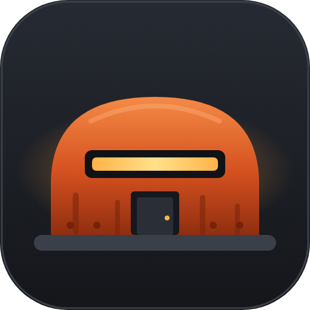

</div>
